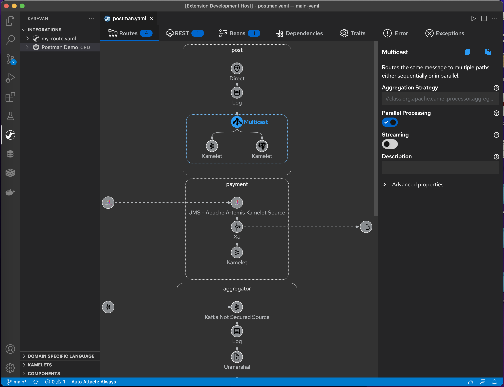
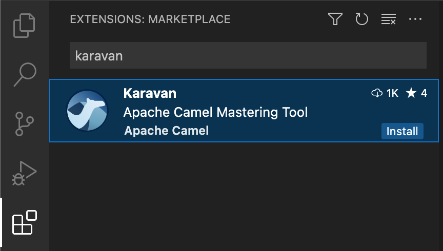
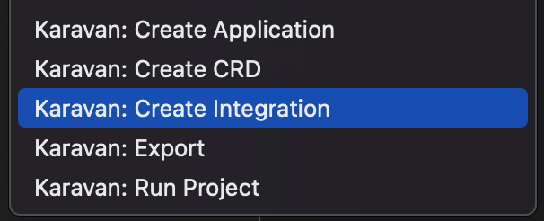
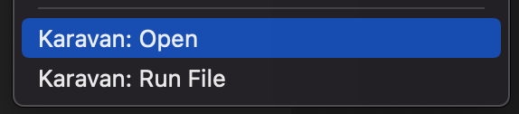
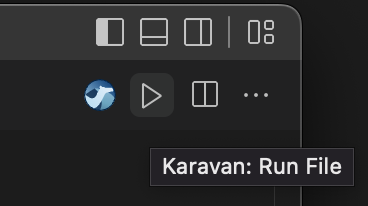
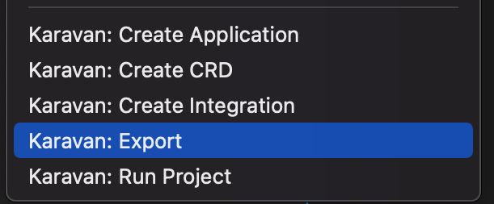

## Apache Camel Karavan
Karavan is an Integration Toolkit for Apache Camel, which makes integration easy and fun through the visualization of pipelines, integration with runtimes and package, image build and deploy to kubernetes out-of-the-box.



Integrations could be created using visual designer that includes Enterprise Integration Patterns DSL, REST API and Beans builder, all Camel Kamelets and Components. 

Karavan uses YAML (Integration CRD or plain) to read/write integrations.

Integrations could be run directly from Karavan UI using Camel JBang. Also they could exported in Maven project with preconfigured Camel Quarkus, Camel Spring-Boot or Camel Main runtime.

Integration project output is a runnable uber-jar or an OCI image for local environment or a deployed application to a Kubernetes/OpenShift in any cloud provider.


## Features
### Visual Designer for Integrations
* Enterprise Integration Patterns DSL
* REST DSL designer
* OpenAPI to REST DSL generator
* Beans and dependencies
* 100+ Kamelets source/sink/action
* 300+ Components consumer/producer
* Read/Write Integration CRD (*.yaml with kind:Integration) and plain yaml routes
### Runtimes
* [Camel JBang](https://camel.apache.org/manual/camel-jbang.html)
* [Camel Quarkus](https://camel.apache.org/camel-quarkus)
* [Camel Spring-Boot](https://camel.apache.org/camel-spring-boot)
* [Camel Main](https://camel.apache.org/components/3.18.x/others/main.html) (WIP)
### Build and Deploy
* Maven for local development
* Tekton Pipelines for Kubernetes/OpenShift
### Documentation
Build-in catalogues:
* Enterprise Integration Patterns
* Kamelets
* Components


# Installation

## Prerequisites
* Microsoft VS Code installed. You can get the most recent version from (https://code.visualstudio.com/) for your chosen operating system.
* [Camel JBang] installed(https://camel.apache.org/manual/camel-jbang.html)

## How to install
1. Open your VS Code Integrated Development Environment (IDE).
2. In the VS Code Activity Bar, select Extensions. (Alternatively, press Ctrl+Shift+X).
3. In the search bar, type **Karavan**
4. In the **Apache Camel Karavan** box, click **Install**.



# Create and edit integration 

## Create new Integration



## Edit an existing Integration




# Run integration

The **Camel version** extension setting controls the version passed to Camel JBang.
Leave it empty to omit `-Dcamel.jbang.version` and let Camel JBang select its default version.

## Custom Kamelets

Set **Karavan: Custom Kamelets Path** (`Karavan.kameletsPath`) to a local
directory, a single YAML file, or an HTTP(S) URL serving raw YAML:

```json
{
  "Karavan.kameletsPath": "C:\\camel\\kamelets.yaml"
}
```

Alternatively, use a URL such as `https://example.com/kamelets.yaml`.
Each non-empty YAML document must have `kind: Kamelet`. A file can contain
multiple Kamelets separated by `---`; LF and CRLF line endings are supported.
Custom Kamelets are loaded alongside the built-in catalog when the designer
loads. Reopen the designer after changing the setting.
Both built-in and custom catalogs support LF and CRLF line endings.

Directory loading remains non-recursive and reads filenames ending in `yaml`.
Relative local paths retain their existing resolution against the extension
host's working directory; absolute paths are recommended.

`Karavan.kameletsPath` is **editor-only**, including directory sources: it is
never passed to Camel JBang run/export or downloaded into the integration project.
Remote loading has a 30-second timeout and reports HTTP, network, and YAML errors.
Browser-hosted extensions also require the server to allow cross-origin requests.

If you previously relied on `Karavan.kameletsPath` for runtime Kamelets, supply
`--local-kamelet-dir` explicitly when running or exporting with the CLI.

## Run integration locally
* Run in UI: click `Run` button 



* Run using CLI
    ```shell
    jbang -Dcamel.jbang.version=4.22.2 camel@apache/camel run $INTEGRATION.yaml --max-messages=10 --logging-level=info
    ```

## Export integration to Maven project

* Export using context menu


* Export using CLI
    ```shell
    jbang -Dcamel.jbang.version=4.22.2 camel@apache/camel export --directory=export
    ```

# Issues

If you find a new issue, please [create a new issue report in GitHub](https://github.com/apache/camel-karavan/issues)!
